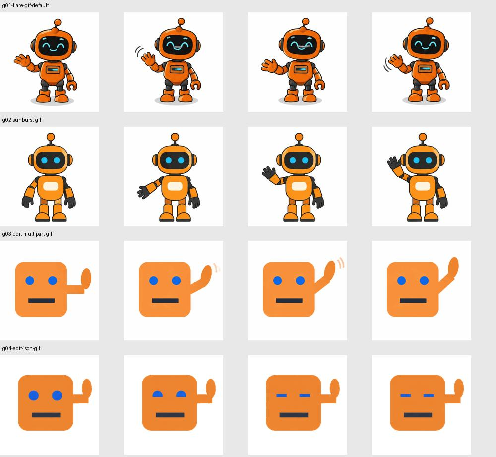
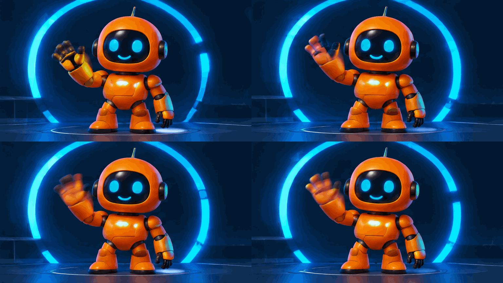

# GPT Image 2.6 实测报告：GIF、SVG、尺寸与 Lumen 接入

测试日期：2026-11-05，Asia/Shanghai；请求开始时间范围 17:16:22–17:32:22。
测试地址：https://flux.infpro.me/v1；凭据仅在进程内使用，报告、脚本及证据不保存 key。
目标项目：CodePier 的 Lumen。此前接口能力实测与报告交付阶段未修改产品代码、提交、推送或部署；随后产品优化及本次 v1.2.185 发布准备见第9节。公开证据范围见[精选证据发布说明](image26-evidence-publication.md)。

## 1. 结论

共完成 **73 次生成/编辑/视觉请求：40 次 HTTP 200，33 次 HTTP 400**。400 包含有意验证的参数边界和不支持路径，不等于随机失败。另通过 CodePier 成功读取一次 `/v1/models`，不计入此矩阵。

- **文生 GIF、图生 GIF 均跑通**：Flare、Sunburst 都有成功样本。图生支持 PNG/JPEG/WebP 静态参考图，multipart 与 JSON 数据 URL 两种请求均成功。
- **GIF 实测帧数 2–16，默认 9**；17、64、65 被拒绝。最小延时 20 ms，即编码 50 FPS；16 帧最快只形成 0.32 秒循环。
- **原生 GIF 尺寸不是静态图尺寸规则的简单套用**：单帧、内部帧拼图、n 张动画总预算共同限制。512×512 静态 PNG 不通过，但同尺寸 GIF 通过；256×256 的 4 帧失败，16 帧成功。
- **文生 SVG 跑通**：这个服务要求 `svg.model`。`gpt-6.1-sol` 已实测可用；两款 2.6 图片模型均成功返回真正 SVG 路径和形状。
- **原生图生 SVG 不支持**：`/images/edits` 拒绝 SVG 输出；添加 `svg` author 或向 generations 添加 `images` 也被拒绝。
- **图生 SVG 的独立替代路径跑通**：`/responses` + `gpt-6.1-sol` 读取图片、输出 SVG 代码，成功解析并渲染。这是视觉模型写代码，不是 Image 2.6 原生图生 SVG。
- **原生 4K、16 帧 GIF 失败**：服务返回总像素预算超限。已交付 768×432 原生动画经 5 倍 Lanczos 放大后的 3840×2160 GIF，16 帧、20 ms、50 FPS。必须标注放大版。

本次 HTTP 200 产生 49 个 Images API 媒体文件，另有 1 个 Responses 输出的 SVG。每个原始成功文件均解码检查格式/尺寸，并记录 SHA-256；GIF 逐帧检查计时和不同帧数，SVG 解析 XML 并检查其元素。代表样本进行了目视检查，不能将少量简单图形的结果外推为复杂场景质量保证。

## 2. 官方文档怎么说

本次实际读取以下官方页面，快照随证据保留：

1. [图片生成指南：2.6、SVG、GIF](https://developers.openai.com/api/docs/guides/image-generation)
2. [Images generations API Reference](https://developers.openai.com/api/reference/resources/images/methods/generate)
3. [Images edits API Reference](https://developers.openai.com/api/reference/resources/images/methods/edit)
4. [GPT Image 2.6 Sunburst](https://developers.openai.com/api/docs/models/gpt-image-2.6-sunburst)
5. [GPT Image 2.6 Flare](https://developers.openai.com/api/docs/models/gpt-image-2.6-flare)

**官方没有给出 GIF 请求总像素预算的数值常量。** 指南只要求帧数、帧尺寸和动画数量满足模型尺寸限制及总请求预算；超出时减少它们，或使用 `size=auto`。因此下文约 16.78 MP 是此网关的实测推断，不是 OpenAI 公布的固定 GIF 上限。

| 项目 | 指南 | API Reference | 本次结论 |
|---|---|---|---|
| GIF 帧数 | 2–64 | 2–16，默认 9 | 服务接受 2、4、9、16，拒绝 1、17、64、65 |
| GIF 帧时长 | 20–2000 ms | 至少 20 ms；10 ms 粒度；编码上限 655350 ms | 2100 成功；655360 被编码为 655350 |
| 图生 GIF | 写 edits 不支持 GIF 输出 | edits 枚举列出 GIF，要求相应 preview 访问能力 | 该 key 的 PNG/JPEG/WebP 图生 GIF 成功 |
| 原生图生 SVG | 不支持 SVG edits | edits 请求枚举不含 SVG | 被拒绝 |
| SVG author | 图像模型生成参考图，再由 author 写 SVG | 开启 author 选择时必须给 `svg.model` | 此服务必须填写；gpt-6.1-sol 成功 |
| GIF 总预算 | 没有公开数字 | 没有公开数字 | 只能报告实测区间和推断 |

指南静态图尺寸段落明确以 GPT Image 2.5 为主体，写有 16 对齐、最长边 3840、比例不超过 3:1、像素 655360–8294400。不能直接把这里的 8294400 写成官方 GIF 整个请求上限。本次 2.6 静态图和 GIF 拼图的行为与部分规则相符，但仍是服务实测结果。

`complexity` 与 `quality` 分开：官方 2.6 complexity 为 low/medium/high，省略默认 high；quality 控制参考图/渲染质量。常规矩阵用 low quality，4K 动画源用 high quality + low complexity。没有做全面画质分档对比。

## 3. GIF 文生、图生与文件输入

| 路径 | 证据用例 | 结果 |
|---|---|---|
| Flare 文生，参数默认 | g01 | 512×512，9 帧，200 ms，1.8 秒，循环 |
| Sunburst 文生 | g02 | 512×512，4 帧，100 ms |
| PNG → GIF，multipart | g03 | 512×512，4 帧，100 ms |
| PNG → GIF，JSON images | g04 | 同上；输入图形被保留，眨眼帧发生变化 |
| JPEG/WebP → GIF | g60-input-jpg / webp | 均成功 |
| Sunburst PNG → GIF | g64 | 成功 |
| 原始 GIF 输入 | g62 | unsupported_file_mimetype |
| 原始 SVG 输入 | g63 | unsupported_file_mimetype |
| 现有 GIF 提取首帧 PNG → 新 GIF | g75 | 成功；是重新生成动画，不能声称保留原时间轴 |
| GIF 透明背景 | g50 | 成功，实际解码存在透明像素 |
| 一次生成两张 GIF | g49 / g72 | 返回两张；4 帧和 16 帧均成功 |
| streaming / compression / partial | g47 / g73 / g74 | 拒绝；不要发送这些组合 |

代表图生 GIF 的机器人保留橙色方形身体、蓝色眼睛和抬起的手；挥手/眨眼确实发生变化。逐帧不同不等于完美无缝，本次没有量化循环接缝或长周期一致性。



### 可复现文生请求

```json
{
  "model": "gpt-image-2.6-flare",
  "prompt": "An orange robot waves its right hand. Seamless loop, fixed camera.",
  "output_format": "gif",
  "size": "512x512",
  "quality": "low",
  "frame_count": 16,
  "frame_duration_ms": 20,
  "n": 1
}
```

发送到 `POST /v1/images/generations`。解码 `data[i].b64_json` 保存 `.gif`，不要将第一帧转成 PNG 后当作动画结果。

图生可发送到 `POST /v1/images/edits`：multipart 使用 `image` 文件字段；JSON 使用 `images: [{"image_url": "data:image/png;base64,..."}]`。其他参数同上。完整成功/失败请求见 `cases/<id>/request.json`，图片数据 URL 已省略。

## 4. GIF 尺寸与两层预算

### 实测尺寸表

| 单帧尺寸 | 帧数 | 结果/原因 |
|---|---:|---|
| auto | 默认 9 | 实际 512×512 |
| 256×256 | 4 | 失败，内部 1024×512 / 512×1024 拼图低于最小预算 |
| 256×256 | 16 | 成功 |
| 512×256 / 256×512 | 4 | 成功，返回精确尺寸 |
| 512×512 | 2 / 4 / 9 / 16 | 成功 |
| 768×512 | 4 | 成功 |
| 768×768 | 4 / 9 | 成功 |
| 1024×768 / 768×1024 | 4 | 成功 |
| 1024×1024 | 4 | 失败，候选拼图 4096×2048 / 2048×4096 超过最长边 |
| 960×960 | 9 | 成功；3×3 拼图 2880×2880 = 8294400 |
| 736×736 | 16 | 失败；4×4 拼图 2944×2944 = 8667136 |
| 768×432，严格 16:9 | 16 | 成功，作为 4K 放大源 |
| 513×512 | 4 | 失败，对齐不满足 |
| 3840×2160 | 4 / 16 | 失败，总预算超限 |

**层一：单张内部帧拼图。** 已观察的拼图与约 8.29 MP、最长边 3840 的限制相符。9 帧 960×960 成功，16 帧 736×736 失败。官方不公开拼图选型算法，因此不要把这些样本硬推成适用于所有帧数的公式。

**层二：整个请求的所有拼图。** 本服务实测预算区间为 **[16777216, 16784640)**，很可能使用 **16777216 = 2²⁴**；精确常量未由官方或服务端返回确认。

| 用例 | 内部拼图总像素 | 结果 |
|---|---:|---|
| 960×960、9 帧、n=2 | 2880×2880×2 = 16588800 | 成功 |
| 960×960、9 帧、n=3 | 2880×2880×3 = 24883200 | 拒绝 |
| 512×512、2 帧、n=8 | 2048×1024×8 = **16777216** | 成功，返回 8 张 |
| 512×512、2 帧、n=9 | 2048×1024×9 = 18874368 | 拒绝 |
| 496×752、9 帧、n=5 | 1488×2256×5 = **16784640** | 拒绝 |

其中 2 帧请求的错误回执显示仍使用 4×2 或 2×4 的 8 格拼图。所以 **最终帧总像素 `W×H×frame_count×n` 不能代替拼图预算**；空位也可能消耗拼图面积。对 n=8 的成功拼图面积，是根据相邻 n=9 的错误中候选布局推断，而非成功响应公开的内部字段。

## 5. 帧率、延时、循环时长

```text
编码 FPS = 1000 / 每帧毫秒数
循环时长 = 实际帧数 × 实际每帧毫秒数
```

| 请求 ms | 实际 ms | 编码 FPS | 证据 |
|---:|---:|---:|---|
| 15 | 拒绝 | — | g30 |
| 20 | 20 | 50 | g25、g81 |
| 33 | 30 | 33.33 | g21 |
| 40 | 40 | 25 | g31 |
| 66 | 70 | 14.29 | g32 |
| 100 | 100 | 10 | 多个成功样本 |
| 125 | 120 | 8.33 | g33 |
| 200 | 200 | 5 | g01 |
| 2000 | 2000 | 0.5 | g34 |
| 2100 | 2100 | 0.476 | g35 |
| 655360 | 655350 | 约 0.001526 | g36 |

125→120 是本次服务行为；不要根据一次样本宣称所有中间值的固定舍入算法。要严格控速，主动提交 10 ms 的整数倍。播放器可能受性能或最短延时策略影响，文件声明的 50 FPS 不代表每个播放器实际显示都达到 50 FPS。

已有 GIF 的单纯变速不需要重新生成。`retime_gif.py` 只改 GIF Graphic Control Extension 中的 delay，实测 100→50 ms，本次局部变速样本为 **4 帧**，逐帧像素哈希及其他文件字节保持一致。初次使用重新编码的方法出现像素变化，未采用；保留记录用于说明为什么最终选择仅修改 delay。

## 6. SVG 文生与图生

### 原生文生：已成功

```json
{
  "model": "gpt-image-2.6-flare",
  "prompt": "An orange robot with blue eyes waving its hand, clean editable vector shapes.",
  "output_format": "svg",
  "size": "1024x1024",
  "quality": "low",
  "n": 1,
  "svg": {"model": "gpt-6.1-sol", "reasoning": {"effort": "low"}}
}
```

- `model` 是参考图模型；`svg.model` 是 SVG author，两者职责不同。
- Flare 1024×1024：6649 字节，44 个 path，79.401 秒。
- Sunburst 1536×864：6105 字节，39 个 path，99.009 秒。
- 两个 SVG 均是可解析的 UTF-8 XML、包含形状/路径/渐变，不含内嵌 raster、脚本或外部引用；经 resvg 渲染并目视确认。
- `svg_usage.model` 返回 gpt-6.1-sol，并分别报告 author token 使用；不能只算参考图的 `usage`。
- 省略 `svg.model`、n=2、stream、output_compression 均失败。
- size=512×512 失败，因为参考图低于最小像素预算。生成后如需小尺寸矢量显示，可在消费端缩放 SVG viewBox；这不表示接口支持该尺寸生成。


### 原生图生：已确认不支持

`/images/edits` multipart 与 JSON 请求都明确拒绝 `output_format=svg`；给 edits 添加 `svg` 触发 unknown_parameter；给 generations 添加 `images` 也触发 unknown_parameter。不要通过增加这些字段宣称原生图生 SVG 已支持。

### 可用替代：视觉模型 → SVG 代码

`s11-vision-to-svg-alternative`：`POST /responses`，模型 gpt-6.1-sol，包含 `input_text` 与 PNG data URL 的 `input_image`，`store=false`，不调用工具。结果返回 SVG 文本，6.551 秒；解析后渲染，形状与参考图的方形身体、眼睛、嘴和右手位置相符。

这适用于简单 logo/图标的重绘。本次只有一个简单几何样本，不保证照片自动追踪、任意复杂图形忠实转换或与 Image 2.6 同等画质。必须在产品中标成独立流程，输出仍需验证后保存。


## 7. 静态图补充验证

Flare PNG 的 1024×1024、1536×864、864×1536、3840×2160 均成功且返回精确尺寸；512×512 被拒绝。`background=transparent` 的 PNG/WebP 均含实际 alpha，JPEG 被拒绝。4K 静态图成功不能证明 4K GIF 成功。

## 8. 4K、16:9、最大帧数、最快帧率成品

原生请求 `3840x2160 + 16 frames + 20 ms` 返回 400 总像素预算超限。随后使用 `768x432 + 16 frames + 20 ms + quality=high + complexity=low` 成功生成动画，用 Lanczos 放大 5 倍并重新量化为 GIF。

- 成品：`robot-4k-16x9-16frames-50fps-upscaled.gif`。
- 实际 3840×2160，16 个不同帧，全部 20 ms，循环 0.32 秒，无限循环。
- 文件 25374369 字节（约 25.37 MB）。
- Pillow 逐帧验收和 ffprobe 均确认；ffprobe 为 50/1、0.320000 秒、16 帧。
- **这是放大版，不是原生 4K，也没有新增 4K 原生细节。** 最高帧率并不意味着最长动画；16 帧在 50 FPS 下非常短。

完整本地证据档案中的文件名：`robot-4k-16x9-16frames-50fps-upscaled.gif`（4K放大版）及`cases/g81-4k-source-768x432-16f-50fps/output-0.gif`（原生768×432）；这两份完整动画不随Git发布。



## 9. 对 Lumen 的具体建议

在此前能力实测阶段，CodePier 项目已有 2.6、GIF、SVG author 相关实现和未提交修改；该阶段只阅读适用规则与相关文件，未替换产品代码。当前节点的参考 HEAD 为 `f84ea2d979708d5551d8defef09bbf45559016d2`，但工作区有大量变动，不能将所有观察绑定为该 commit 的纯净代码。

1. 此服务的 SVG 配置应填写经本次验证的 `gpt-6.1-sol` author，不要从 `/models` 出现某名称就推定其 author 能力；本次是实际调用证明。
2. 原生图生 SVG 应明确显示不支持；若增加视觉转 SVG，作为独立功能、路由与结果类型，不要静默替换。
3. 现有 `apps/web/src/lib/gifSize.ts` 只验证正整数及 16 对齐；这不是完整的上游尺寸可用性校验。优先提供经过验证的尺寸/帧数组合，给出服务错误，不要只显示“合法尺寸”。
4. GIF 2–16、20–2000 ms 是合理的保守 UI 区间，但 2000 ms 与 n=1 是产品选择，不是该网关硬限制。实测 n=2 与 n=8 都有成功案例。
5. 不可直接套用静态图最小像素预算到 GIF 单帧，也不可将 8.29 MP 作为 GIF 整个请求总量。
6. `output_format`、frame_count/duration、complexity、svg author 必须透传；GIF/SVG 禁止流式、partials 和 compression 组合。返回后检查真实字节格式、帧数、尺寸及有效 XML。
7. GIF 已有帧变速应优先修改 delay；有意重新生成时提取 PNG 并说明会重新生成时间轴。
8. `/v1/models` 返回了 2.5 却没有 2.6，实际 2.6 可调用；模型列表不是最终可用性依据。

### 优化落实记录（2026-11-05，v1.2.185 发布前验收快照）

本节是 v1.2.185 发布前验收快照，区分原始网关实测和随后按报告进行的 Lumen 代码优化。原始请求及证据保持不变；本轮优化及发布准备没有重新调用付费模型。2026-11-05 12:23 UTC 用户授权后进入正式提交、推送和发布准备，并要求正式镜像验证后更新 VPS。本快照的生产基线为 v1.2.184，优化建立在既有 SVG author/GIF 尺寸修复之上；发布成功与最终生产状态以正式 Release、镜像验证和部署回执为准，不能从本节推断已经发布。

离线复核已确认：73 个 case 与总表一致（40 个 200、33 个 400）；证据清单中的 235 个文件 SHA-256 全部匹配；49 个 Images API 原媒体的 hash 全部匹配，分别为 41 GIF、2 SVG、5 PNG、1 WebP。Responses 替代路径的 SVG 文件也存在并匹配清单。没有重放失败、未发送或结果不明的请求。

已确认的作者型号不是猜测：s03、s06 均实际使用 `svg.model=gpt-6.1-sol` 返回 200，响应独立返回 `svg_usage.model`。这只证明该测试网关和当时凭据的能力，不代表所有供应商、账号或以后版本的默认契约。官方参考仍没有枚举可通用的 SVG 作者 ID。

| 第9节建议 | 实现结果 | 边界及证据 |
|---|---|---|
| 1：经验证的 SVG author | 增加供应商限定建议、作者输入及清楚标注适用通道的提示；保留用户原值，不自动填充或改配置 | 后端只匹配 HTTPS `flux.infpro.me/v1` 的规范地址；其他通道返回无建议。s03/s06 证明该通道的 `gpt-6.1-sol`，不由 `/models` 推定 |
| 2：原生编辑与视觉重建 | 原生 SVG 编辑在界面、请求校验及 direct 调用前拒绝；另有显式的一次性“视觉模型重建 SVG（文本计费）”入口 | 一张自有静态 PNG/JPEG/WebP；使用标准视觉聊天模型和 Completion，不静默切换 Image 2.6 请求，不将 SVG/GIF 输入暗中栅格化；草稿及原生图像设置保留 |
| 3：GIF 尺寸组合 | 增加六个明确的尺寸/帧数参考预设，保留自定义及 `auto`；修复 worker 将 auto 误改为静态预设 | 预设同时修改的尺寸和帧数清楚显示；16 对齐只是必要条件，提供真实服务错误，不推断未知组合一定可用 |
| 4：保守范围 | 增加请求 FPS、循环时长和产品范围说明；不合法的 10 ms 粒度拒绝而非偷偷改值 | `n=1`、2–16 帧、20–2000 ms 是当前 Lumen 选择，不把 2000 ms 或 n=1 写成网关硬上限 |
| 5：尺寸与预算 | 保留现有生成安全预算，不添加推测的拼图公式、统一 16.78 MP 常量或静态最小单帧预算 | GIF 元数据检查沿用生成路径的 50 MiB 文件预算，不误用本地 GIF 编辑器的 32 MiB 限制；未知网关预算由实际错误说明 |
| 6：请求与实际产物 | 参数全链路保留；实际 GIF 尺寸、帧数、逐帧延时、loop 与请求差异写入诊断并展示；SVG 作者用量单独保留 | 0/缺失延时显示未知，不等帧延时不虚称统一 FPS；可用结果即使不完全匹配也保留，绝不自动再付费生成。作者 usage 保留真实零值，不混成图像用量、不编造作者单价 |
| 7：本地变速与重新生成 | 真实四帧 GIF 样本验证纯变速只改 delay、逐帧像素相同；保留既有本地提帧/替换流程 | 选择帧重新调用模型是另一项操作，不能宣称保留原时间轴或已实现一键 AI 编辑回填 |
| 8：模型列表 | 确认前端选择器和请求 schema 使用明确的 2.6 Flare/Sunburst 模型表，保留旧任务兼容 | 这些入口不依赖 `/models` 发现；不能因列表缺失禁用实测可调用的 2.6，也不宣称审计了所有供应商内部路由 |

**独立视觉重建 SVG 的实现约束。** s11 返回的是普通 Responses 文本，图像工具用量为零。因此实现使用显式 Completion 模式和文本模型价格快照，不把 SVG 文本塞入现有 `tool_images` 路径；该路径会补记图像工具用量。入口须写明“视觉模型重建 SVG，非 Image 2.6 原生图生 SVG”，只处理本次提示词和一个已鉴权的 PNG/JPEG/WebP，不隐式发送聊天历史、长期记忆或工具配置。

上游完成凭据、原文本和实际 token 用量必须先可靠保存，再执行 SVG 验证、渲染和私有存储。模型已成功但本地处理失败时仍结算已发生的文本用量，显示“SVG 未交付”，只允许从已有凭据做本地重处理，不能自动再调模型。来源、源图片 hash、实际模型、请求/响应身份和产物 hash 要可追溯；重启、双击、并发或旧执行 epoch 不得重复插图、收费或发布。缺价沿现有阻断/待对账规则，不编造单价。非法 SVG 仅保留为转义私有文本，不作为可执行图片展示。

实现以现有完成凭据为恢复基础，不重复创造一套收据或把已完成模型请求再发一次。产物 ID 由 completion ID 与真实 response ID 稳定派生；上游 HTTP request ID 未暴露时留空，不伪造。源图上限 20 MiB/16 MP，SVG 上限 1 MiB/10000 元素/16 MP/单边8192；API 省略输出上限时默认2048 tokens；界面显式使用16000输出 tokens 上限并提示费用，实际按用量结算。wallet 预检沿用现有最低预留与缺价校验，不声称预存了最大 token 全额。缺失或不精确用量进入待对账，不使用正数估算冒充精确扣款。

**本轮已完成的后端验收。** 原生契约专项 core 172、API 17、worker 142 项通过，worker 另有1项本机缺 libvips 的既有跳过；视觉 Completion 专项 worker 365、API 61 项通过。随后将旧 SVG/GIF 修复和新功能组合运行，core 68、API 91、worker 117 项通过。数量存在交集，不能相加当作独立用例总数。组合测试修正了一处旧指纹测试夹具，使其准确排除历史 schema 不存在的空 `artifact_format`；实际幂等实现没有放宽。

VPS 另用原 v1.2.184 worker 运行时、最终视觉模块、无网络非 root 隔离容器执行真实 libvips 8.16.1 和 LocalStorage 验收，38项通过，覆盖原始字节、三种预览、四文件存储、恶意 SVG、稳定身份、孤立文件接管及部分写入失败后的本地恢复。数据库/session/event 边界是内存替身，不能称作真实 PostgreSQL 并发或完整生产端到端验收。没有使用生产挂载、模型凭据或付费请求，生产版本未切换。

**最终前端与整合验收。** 全量前端1231/1231单测、类型检查、完整 lint（含架构与复杂度）、最终生产构建和桌面/手机 Chrome 26/26场景通过；浏览器保持45秒标准时限、零重试，未通过延长断言或放宽规则掩盖失败。原始SVG下载核对实际保存字节；首次本地修复仍失败后，经最新Completion GET可再次本地修复，未发模型请求。最终截图实际复看，修正了手机长SVG原文撑宽卡片的问题；GIF实际参数与请求差异清晰区分。移除临时Playwright配置、按语义与SHA守卫恢复优化后的tsconfig后，最终类型检查再次通过。现有 privacy 页的一条 ESLint warning 保留，未改规则或基线。

早期生产构建曾在网络盘 build traces 阶段超过900秒；确认原进程结束后，沿同一隔离缓存以1800秒时限完成，未关闭tracing。随后UI审查修复后的最终代码另有完整成功构建，不借用旧包结论。组合测试首次失败的历史指纹夹具与新增测试Ruff样式均已修正并复测；后端完整作用域Ruff和差异检查通过。上述均为未提交候选的本地/隔离验收，不是新版本已发布或完整仓库CI通过的声明。

独立审查发现并修复“不精确用量的正数 token fallback 可能实际收费”问题，新增测试明确要求走待对账且不调用 charge/release。Safari、真实 PostgreSQL 并发、此新流程的真实模型调用尚未验收。4K 放大样本仍只是第8节的独立派生成品，不代表 Lumen 新增原生4K GIF、自动放大或无损矢量化功能。

## 10. 证据、重跑与局限

以下列出完整本地档案内容，不表示这些原始文件全部随Git发布。公开版本仅提供[73例白名单摘要](image26-public-case-summary-2026-11-05.md)及4张精选预览；来源、hash与保留范围见[精选证据发布说明](image26-evidence-publication.md)。

- `cases/<id>/request.json`：去除凭据及图像 base64 的实际请求摘要。
- `cases/<id>/result.json`：HTTP 状态、耗时、响应元数据/错误、真实文件检查、hash；成功响应的 base64 替换为占位，原始媒体独立保存。
- `results.json` / `results.csv`：完整矩阵。
- `probe.py`：key 使用隐藏输入，仅保留在进程内；已有 result 的 ID 不重放；HTTP 不自动重试。`batch*.json` 提供批次，未发送的 batch11 不纳入结果。
- `official-*.md`：测试时官方正文快照；`project-read-baseline.json`：只读文件 hash。
- `retime_gif.py` / `make_4k.py` / 对应 JSON：派生文件处理及验收证据。
- `manifest.json`：本证据包文件 SHA-256 清单。

实际付费调用来自本机 Python requests 直接访问指定网关；CodePier 用于打开 Lumen、读取规则与接入说明、模型发现和报告回存。其执行节点多次连接中断，因此没有重放不确定的远端操作。CodePier 审阅基线创建因 REVIEW_QUOTA 失败；此前能力实测阶段仅创建新的报告/证据路径，没有覆盖当时已有源码或未提交修改。随后产品优化另见第9节。

本次多数用例只调用一次，不是统计稳定性/性能基准；并发最多 2。接口返回模型名/usage 不构成对服务内部路由的独立证明。未测试所有合法尺寸、全部 quality 档、所有 author、完整 Responses image tool、mask/markup 或 Lumen 生产网页端到端流程。本次不提供这几个未测维度的通过结论。生成 token 见回执，未读取账单，不能把官方定价估算当作实际扣款。

## 11. 完整请求矩阵

以下所有条目均为实际请求；短 ID 说明和完整 payload/error 见链接。状态 400 以错误回执为依据。

| ID | 路径 | 模型 | 请求尺寸/格式/帧 | HTTP | 秒 | 实际结果或错误 |
|---|---|---|---|---:|---:|---|
| [g01-flare-gif-default](image26-public-case-summary-2026-11-05.md#g01-flare-gif-default) | /images/generations | gpt-image-2.6-flare | auto / gif / defaultf | 200 | 14.861 | GIF 512x512 9f/200ms |
| [g02-sunburst-gif](image26-public-case-summary-2026-11-05.md#g02-sunburst-gif) | /images/generations | gpt-image-2.6-sunburst | 512x512 / gif / 4f | 200 | 18.181 | GIF 512x512 4f/100ms |
| [g03-edit-multipart-gif](image26-public-case-summary-2026-11-05.md#g03-edit-multipart-gif) | /images/edits | gpt-image-2.6-flare | 512x512 / gif / 4f | 200 | 8.397 | GIF 512x512 4f/100ms |
| [g04-edit-json-gif](image26-public-case-summary-2026-11-05.md#g04-edit-json-gif) | /images/edits | gpt-image-2.6-flare | 512x512 / gif / 4f | 200 | 10.127 | GIF 512x512 4f/100ms |
| [g10-size-256x256](image26-public-case-summary-2026-11-05.md#g10-size-256x256) | /images/generations | gpt-image-2.6-flare | 256x256 / gif / 4f | 400 | 0.4 | No supported sheet fits 4 GIF frames at size '256x256'. Invalid size '1024x512'. Requested resolution is below the current minimum pixel budget. Invalid size '512x1024'. Requested resolution is below the current minimum pixel budget. |
| [g11-size-512x256](image26-public-case-summary-2026-11-05.md#g11-size-512x256) | /images/generations | gpt-image-2.6-flare | 512x256 / gif / 4f | 200 | 7.393 | GIF 512x256 4f/100ms |
| [g12-size-256x512](image26-public-case-summary-2026-11-05.md#g12-size-256x512) | /images/generations | gpt-image-2.6-flare | 256x512 / gif / 4f | 200 | 7.176 | GIF 256x512 4f/100ms |
| [g13-size-768x512](image26-public-case-summary-2026-11-05.md#g13-size-768x512) | /images/generations | gpt-image-2.6-flare | 768x512 / gif / 4f | 200 | 9.845 | GIF 768x512 4f/100ms |
| [g14-size-1024x1024](image26-public-case-summary-2026-11-05.md#g14-size-1024x1024) | /images/generations | gpt-image-2.6-flare | 1024x1024 / gif / 4f | 400 | 0.59 | No supported sheet fits 4 GIF frames at size '1024x1024'. Invalid size '4096x2048'. The longest edge must be less than or equal to 3840. Invalid size '2048x4096'. The longest edge must be less than or equal to 3840. |
| [g20-frames-2](image26-public-case-summary-2026-11-05.md#g20-frames-2) | /images/generations | gpt-image-2.6-flare | 256x256 / gif / 2f | 400 | 0.624 | No supported sheet fits 2 GIF frames at size '256x256'. Invalid size '1024x512'. Requested resolution is below the current minimum pixel budget. Invalid size '512x1024'. Requested resolution is below the current minimum pixel budget. |
| [g21-frames-16](image26-public-case-summary-2026-11-05.md#g21-frames-16) | /images/generations | gpt-image-2.6-flare | 256x256 / gif / 16f | 200 | 9.481 | GIF 256x256 16f/30ms |
| [g22-frames-17](image26-public-case-summary-2026-11-05.md#g22-frames-17) | /images/generations | gpt-image-2.6-flare | 256x256 / gif / 17f | 400 | 0.398 | Invalid 'frame_count' for GIF output. Received 17. Use an integer from 2 to 16, or omit 'frame_count' to use 9. |
| [g23-frames-64](image26-public-case-summary-2026-11-05.md#g23-frames-64) | /images/generations | gpt-image-2.6-flare | 256x256 / gif / 64f | 400 | 0.596 | Invalid 'frame_count' for GIF output. Received 64. Use an integer from 2 to 16, or omit 'frame_count' to use 9. |
| [g24-frames-65](image26-public-case-summary-2026-11-05.md#g24-frames-65) | /images/generations | gpt-image-2.6-flare | 256x256 / gif / 65f | 400 | 0.367 | Invalid 'frame_count' for GIF output. Received 65. Use an integer from 2 to 16, or omit 'frame_count' to use 9. |
| [g25-count2-valid](image26-public-case-summary-2026-11-05.md#g25-count2-valid) | /images/generations | gpt-image-2.6-flare | 512x512 / gif / 2f | 200 | 8.822 | GIF 512x512 2f/20ms |
| [g30-delay-15](image26-public-case-summary-2026-11-05.md#g30-delay-15) | /images/generations | gpt-image-2.6-flare | 512x512 / gif / 4f | 400 | 0.39 | Invalid 'frame_duration_ms': integer below minimum value. Expected a value >= 20, but got 15 instead. |
| [g31-delay-40](image26-public-case-summary-2026-11-05.md#g31-delay-40) | /images/generations | gpt-image-2.6-flare | 512x512 / gif / 4f | 200 | 8.921 | GIF 512x512 4f/40ms |
| [g32-delay-66](image26-public-case-summary-2026-11-05.md#g32-delay-66) | /images/generations | gpt-image-2.6-flare | 512x512 / gif / 4f | 200 | 14.157 | GIF 512x512 4f/70ms |
| [g33-delay-125](image26-public-case-summary-2026-11-05.md#g33-delay-125) | /images/generations | gpt-image-2.6-flare | 512x512 / gif / 4f | 200 | 7.719 | GIF 512x512 4f/120ms |
| [g34-delay-2000](image26-public-case-summary-2026-11-05.md#g34-delay-2000) | /images/generations | gpt-image-2.6-flare | 512x512 / gif / 4f | 200 | 9.075 | GIF 512x512 4f/2000ms |
| [g35-delay-2100](image26-public-case-summary-2026-11-05.md#g35-delay-2100) | /images/generations | gpt-image-2.6-flare | 512x512 / gif / 4f | 200 | 7.457 | GIF 512x512 4f/2100ms |
| [g36-delay-655360](image26-public-case-summary-2026-11-05.md#g36-delay-655360) | /images/generations | gpt-image-2.6-flare | 512x512 / gif / 4f | 200 | 9.143 | GIF 512x512 4f/655350ms |
| [g40-size-768x768](image26-public-case-summary-2026-11-05.md#g40-size-768x768) | /images/generations | gpt-image-2.6-flare | 768x768 / gif / 4f | 200 | 13.452 | GIF 768x768 4f/100ms |
| [g41-size-1024x768](image26-public-case-summary-2026-11-05.md#g41-size-1024x768) | /images/generations | gpt-image-2.6-flare | 1024x768 / gif / 4f | 200 | 16.199 | GIF 1024x768 4f/100ms |
| [g42-size-768x1024](image26-public-case-summary-2026-11-05.md#g42-size-768x1024) | /images/generations | gpt-image-2.6-flare | 768x1024 / gif / 4f | 200 | 16.488 | GIF 768x1024 4f/100ms |
| [g43-size-3840x2160](image26-public-case-summary-2026-11-05.md#g43-size-3840x2160) | /images/generations | gpt-image-2.6-flare | 3840x2160 / gif / 4f | 400 | 0.371 | GIF frames exceed the total request pixel budget. Reduce the frame size or frame_count. |
| [g44-size-513x512](image26-public-case-summary-2026-11-05.md#g44-size-513x512) | /images/generations | gpt-image-2.6-flare | 513x512 / gif / 4f | 400 | 0.398 | No supported sheet fits 4 GIF frames at size '513x512'. Invalid size '1026x2048'. Width and height must both be divisible by 16. Invalid size '2052x1024'. Width and height must both be divisible by 16. |
| [g45-16frames-512](image26-public-case-summary-2026-11-05.md#g45-16frames-512) | /images/generations | gpt-image-2.6-flare | 512x512 / gif / 16f | 200 | 14.446 | GIF 512x512 16f/100ms |
| [g46-9frames-768](image26-public-case-summary-2026-11-05.md#g46-9frames-768) | /images/generations | gpt-image-2.6-flare | 768x768 / gif / 9f | 200 | 15.664 | GIF 768x768 9f/100ms |
| [g47-stream](image26-public-case-summary-2026-11-05.md#g47-stream) | /images/generations | gpt-image-2.6-flare | 512x512 / gif / 4f | 400 | 0.35 | 'stream' is not supported for GIF output. |
| [g48-count1](image26-public-case-summary-2026-11-05.md#g48-count1) | /images/generations | gpt-image-2.6-flare | 512x512 / gif / 1f | 400 | 0.425 | Invalid 'frame_count' for GIF output. Received 1. Use an integer from 2 to 16, or omit 'frame_count' to use 9. |
| [g49-n2](image26-public-case-summary-2026-11-05.md#g49-n2) | /images/generations | gpt-image-2.6-flare | 512x512 / gif / 4f | 200 | 10.026 | GIF 512x512 4f/200ms; GIF 512x512 4f/200ms |
| [g50-transparent](image26-public-case-summary-2026-11-05.md#g50-transparent) | /images/generations | gpt-image-2.6-flare | 512x512 / gif / 4f | 200 | 11.721 | GIF 512x512 4f/200ms |
| [g60-input-jpg](image26-public-case-summary-2026-11-05.md#g60-input-jpg) | /images/edits | gpt-image-2.6-flare | 512x512 / gif / 4f | 200 | 9.487 | GIF 512x512 4f/100ms |
| [g60-input-webp](image26-public-case-summary-2026-11-05.md#g60-input-webp) | /images/edits | gpt-image-2.6-flare | 512x512 / gif / 4f | 200 | 8.67 | GIF 512x512 4f/100ms |
| [g62-gif-input](image26-public-case-summary-2026-11-05.md#g62-gif-input) | /images/edits | gpt-image-2.6-flare | 512x512 / gif / 4f | 400 | 0.556 | Invalid file 'image': unsupported mimetype ('image/gif'). Supported file formats are 'image/jpeg', 'image/png', and 'image/webp'. |
| [g63-svg-input](image26-public-case-summary-2026-11-05.md#g63-svg-input) | /images/edits | gpt-image-2.6-flare | 512x512 / gif / 4f | 400 | 0.447 | Invalid file 'image': unsupported mimetype ('image/svg+xml'). Supported file formats are 'image/jpeg', 'image/png', and 'image/webp'. |
| [g64-sunburst-edit](image26-public-case-summary-2026-11-05.md#g64-sunburst-edit) | /images/edits | gpt-image-2.6-sunburst | 512x512 / gif / 4f | 200 | 14.997 | GIF 512x512 4f/100ms |
| [g70-9frames-960](image26-public-case-summary-2026-11-05.md#g70-9frames-960) | /images/generations | gpt-image-2.6-flare | 960x960 / gif / 9f | 200 | 17.98 | GIF 960x960 9f/100ms |
| [g71-16frames-736](image26-public-case-summary-2026-11-05.md#g71-16frames-736) | /images/generations | gpt-image-2.6-flare | 736x736 / gif / 16f | 400 | 0.377 | No supported sheet fits 16 GIF frames at size '736x736'. Invalid size '2944x2944'. Requested resolution exceeds the current pixel budget. |
| [g72-16frames-n2](image26-public-case-summary-2026-11-05.md#g72-16frames-n2) | /images/generations | gpt-image-2.6-flare | 512x512 / gif / 16f | 200 | 15.103 | GIF 512x512 16f/200ms; GIF 512x512 16f/200ms |
| [g73-gif-compression](image26-public-case-summary-2026-11-05.md#g73-gif-compression) | /images/generations | gpt-image-2.6-flare | 512x512 / gif / 4f | 400 | 0.364 | 'output_compression' is not supported for GIF output. |
| [g74-gif-partial](image26-public-case-summary-2026-11-05.md#g74-gif-partial) | /images/generations | gpt-image-2.6-flare | 512x512 / gif / 4f | 400 | 0.363 | Partial images are only supported with streaming. |
| [g75-existing-gif-extracted-frame-edit](image26-public-case-summary-2026-11-05.md#g75-existing-gif-extracted-frame-edit) | /images/edits | gpt-image-2.6-flare | 512x512 / gif / 4f | 200 | 10.705 | GIF 512x512 4f/100ms |
| [g80-requested-native4k-16f-50fps](image26-public-case-summary-2026-11-05.md#g80-requested-native4k-16f-50fps) | /images/generations | gpt-image-2.6-flare | 3840x2160 / gif / 16f | 400 | 2.478 | GIF frames exceed the total request pixel budget. Reduce the frame size or frame_count. |
| [g81-4k-source-768x432-16f-50fps](image26-public-case-summary-2026-11-05.md#g81-4k-source-768x432-16f-50fps) | /images/generations | gpt-image-2.6-flare | 768x432 / gif / 16f | 200 | 16.33 | GIF 768x432 16f/20ms |
| [g90-total-960-9frames-n10](image26-public-case-summary-2026-11-05.md#g90-total-960-9frames-n10) | /images/generations | gpt-image-2.6-flare | 960x960 / gif / 9f | 400 | 0.729 | No supported sheet fits 9 GIF frames at size '960x960'. Sheet 2880x2880 exceeds the total request pixel budget for n=10. |
| [g90-total-960-9frames-n2](image26-public-case-summary-2026-11-05.md#g90-total-960-9frames-n2) | /images/generations | gpt-image-2.6-flare | 960x960 / gif / 9f | 200 | 15.218 | GIF 960x960 9f/100ms; GIF 960x960 9f/100ms |
| [g90-total-960-9frames-n3](image26-public-case-summary-2026-11-05.md#g90-total-960-9frames-n3) | /images/generations | gpt-image-2.6-flare | 960x960 / gif / 9f | 400 | 2.095 | No supported sheet fits 9 GIF frames at size '960x960'. Sheet 2880x2880 exceeds the total request pixel budget for n=3. |
| [g91-total512-2frames-n8](image26-public-case-summary-2026-11-05.md#g91-total512-2frames-n8) | /images/generations | gpt-image-2.6-flare | 512x512 / gif / 2f | 200 | 11.511 | GIF 512x512 2f/100ms; GIF 512x512 2f/100ms; GIF 512x512 2f/100ms; GIF 512x512 2f/100ms; GIF 512x512 2f/100ms; GIF 512x512 2f/100ms; GIF 512x512 2f/100ms; GIF 512x512 2f/100ms |
| [g91-total512-2frames-n9](image26-public-case-summary-2026-11-05.md#g91-total512-2frames-n9) | /images/generations | gpt-image-2.6-flare | 512x512 / gif / 2f | 400 | 0.384 | No supported sheet fits 2 GIF frames at size '512x512'. Sheet 2048x1024 exceeds the total request pixel budget for n=9. Sheet 1024x2048 exceeds the total request pixel budget for n=9. |
| [g93-total-just-above-16MiP](image26-public-case-summary-2026-11-05.md#g93-total-just-above-16mip) | /images/generations | gpt-image-2.6-flare | 496x752 / gif / 9f | 400 | 0.423 | No supported sheet fits 9 GIF frames at size '496x752'. Sheet 1488x2256 exceeds the total request pixel budget for n=5. |
| [r01-raster-1024x1024](image26-public-case-summary-2026-11-05.md#r01-raster-1024x1024) | /images/generations | gpt-image-2.6-flare | 1024x1024 / png / defaultf | 200 | 6.634 | PNG 1024x1024 |
| [r02-raster-1536x864](image26-public-case-summary-2026-11-05.md#r02-raster-1536x864) | /images/generations | gpt-image-2.6-flare | 1536x864 / png / defaultf | 200 | 6.969 | PNG 1536x864 |
| [r03-raster-864x1536](image26-public-case-summary-2026-11-05.md#r03-raster-864x1536) | /images/generations | gpt-image-2.6-flare | 864x1536 / png / defaultf | 200 | 6.1 | PNG 864x1536 |
| [r04-raster-3840x2160](image26-public-case-summary-2026-11-05.md#r04-raster-3840x2160) | /images/generations | gpt-image-2.6-flare | 3840x2160 / png / defaultf | 200 | 15.263 | PNG 3840x2160 |
| [r05-raster-512x512](image26-public-case-summary-2026-11-05.md#r05-raster-512x512) | /images/generations | gpt-image-2.6-flare | 512x512 / png / defaultf | 400 | 0.723 | Invalid size '512x512'. Requested resolution is below the current minimum pixel budget. |
| [r10-transparent-jpeg](image26-public-case-summary-2026-11-05.md#r10-transparent-jpeg) | /images/generations | gpt-image-2.6-flare | 1024x1024 / jpeg / defaultf | 400 | 1.117 | Transparent background is not supported for JPEG output format |
| [r10-transparent-png](image26-public-case-summary-2026-11-05.md#r10-transparent-png) | /images/generations | gpt-image-2.6-flare | 1024x1024 / png / defaultf | 200 | 6.583 | PNG 1024x1024 |
| [r10-transparent-webp](image26-public-case-summary-2026-11-05.md#r10-transparent-webp) | /images/generations | gpt-image-2.6-flare | 1024x1024 / webp / defaultf | 200 | 6.988 | WEBP 1024x1024 |
| [s01-flare-svg-default](image26-public-case-summary-2026-11-05.md#s01-flare-svg-default) | /images/generations | gpt-image-2.6-flare | 1024x1024 / svg / defaultf | 400 | 2.587 | SVG generation requires 'svg.model'. |
| [s02-sunburst-svg](image26-public-case-summary-2026-11-05.md#s02-sunburst-svg) | /images/generations | gpt-image-2.6-sunburst | 1024x1024 / svg / defaultf | 400 | 2.39 | SVG generation requires 'svg.model'. |
| [s03-svg-author-sol](image26-public-case-summary-2026-11-05.md#s03-svg-author-sol) | /images/generations | gpt-image-2.6-flare | 1024x1024 / svg / defaultf | 200 | 79.401 | SVG 1024x1024 |
| [s04-edit-multipart-svg](image26-public-case-summary-2026-11-05.md#s04-edit-multipart-svg) | /images/edits | gpt-image-2.6-flare | 1024x1024 / svg / defaultf | 400 | 0.371 | Invalid value: 'svg'. Supported values are: 'png', 'webp', 'jpeg', and 'gif'. |
| [s05-edit-json-svg](image26-public-case-summary-2026-11-05.md#s05-edit-json-svg) | /images/edits | gpt-image-2.6-flare | 1024x1024 / svg / defaultf | 400 | 0.453 | Invalid value: 'svg'. Supported values are: 'png', 'webp', 'jpeg', and 'gif'. |
| [s06-sunburst-author](image26-public-case-summary-2026-11-05.md#s06-sunburst-author) | /images/generations | gpt-image-2.6-sunburst | 1536x864 / svg / defaultf | 200 | 99.009 | SVG 1536x864 |
| [s07-svg-n2](image26-public-case-summary-2026-11-05.md#s07-svg-n2) | /images/generations | gpt-image-2.6-flare | 1024x1024 / svg / defaultf | 400 | 1.126 | The 'n' parameter is not supported for SVG generation. Use n=1. |
| [s08-svg-stream](image26-public-case-summary-2026-11-05.md#s08-svg-stream) | /images/generations | gpt-image-2.6-flare | 1024x1024 / svg / defaultf | 400 | 0.397 | The 'stream' parameter is not supported for SVG generation. |
| [s09-svg-edit-with-author](image26-public-case-summary-2026-11-05.md#s09-svg-edit-with-author) | /images/edits | gpt-image-2.6-flare | 1024x1024 / svg / defaultf | 400 | 0.41 | Unknown parameter: 'svg'. |
| [s10-svg-generations-with-images](image26-public-case-summary-2026-11-05.md#s10-svg-generations-with-images) | /images/generations | gpt-image-2.6-flare | 1024x1024 / svg / defaultf | 400 | 0.37 | Unknown parameter: 'images'. |
| [s11-vision-to-svg-alternative](image26-public-case-summary-2026-11-05.md#s11-vision-to-svg-alternative) | /responses | gpt-6.1-sol | — / text / defaultf | 200 | 6.551 | SVG text → XML parse → rendered PNG; independent vision route |
| [s12-svg-size512](image26-public-case-summary-2026-11-05.md#s12-svg-size512) | /images/generations | gpt-image-2.6-flare | 512x512 / svg / defaultf | 400 | 0.561 | Invalid size '512x512'. Requested resolution is below the current minimum pixel budget. |
| [s13-svg-compression](image26-public-case-summary-2026-11-05.md#s13-svg-compression) | /images/generations | gpt-image-2.6-flare | 1024x1024 / svg / defaultf | 400 | 0.383 | The 'output_compression' parameter is not supported for SVG generation. |
